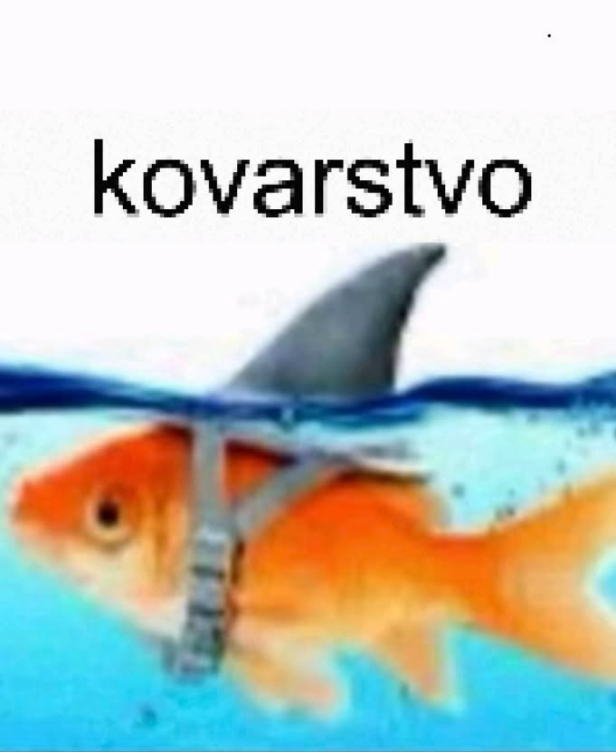

# Лабораторная работа №1

ФИО: Тупасов Артур Ринатович;
Группа: 6405-010302D;
Научный руководитель(де-факто/де-юре): Галанов Кирилл Валерьевич/Бибиков Сергей Алексеевич;
Предполагаемая тема диплома: Исследование методов машинного обучения для
прогнозирования ценообразования на рынке аренды жилья по уровню туризма и сезону;
Любимая цитата известного философа: "По настоящему несгибаемым человека делает не характер и воспитание, а межпозвоночная грыжа." © Д. Стетхэм.

# Лабораторная работа №2
Цель лабораторной работы: изучение основ HTML и CSS.
Задание на программирование: разработать многостраничный web-сайт на произвольно выбранную тему с использованием технологий HTML и CSS, загрузить проект в репозиторий.
Требования к web-сайту:
1.	Количество страниц – от 3 до 5.
2.	Требования к HTML:
2.1.	Использование блочных и строчных элементов.
2.2.	Ссылки – от 1 шт.
2.3.	Картинки – от 1 шт.
2.4.	Таблица – от 1 шт.
3.	Требование к CSS:
3.1.	Отдельный подключаемый файл.
3.2.	Обязательное использование как минимум 3 видов селекторов.
3.3.	Использование цвета.
3.4.	Использование различных видов выравнивания в таблице (по левому/правому краю и по центру).
4.	Запрещено использовать JS, Bootstrap и любые другие библиотеки и фреймворки, всё реализовать самостоятельно.

В результате была написана упрощённая реплика киносайта из 4 взаимосвязанных страниц.

# Лабораторная работа №2
Цель лабораторной работы: изучение основ JavaScript.
Задание на программирование: написать набор функций на языке JavaScript, реализующих требуемый функционал, и загрузить проект в репозиторий.

В результате был написан набор функций на языке JavaScript, реализующих требуемый функционал.